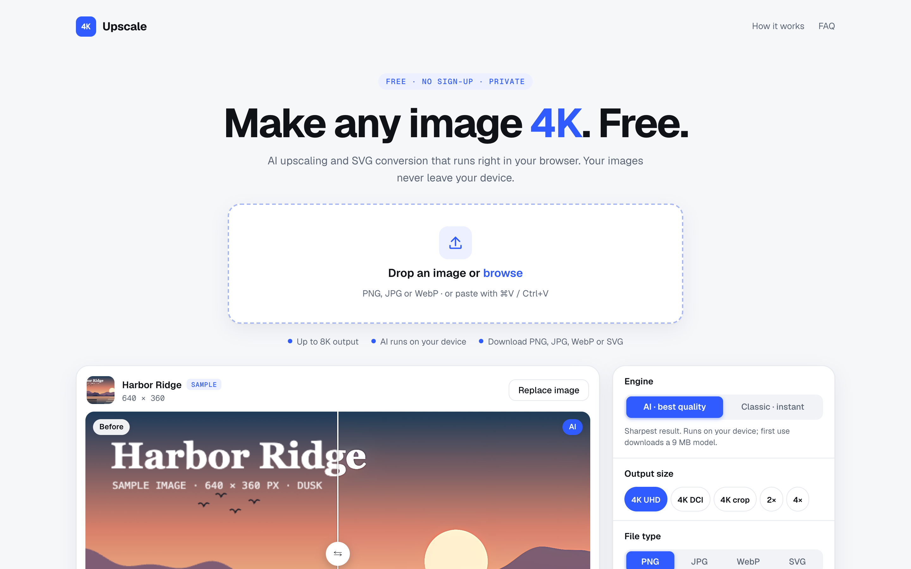
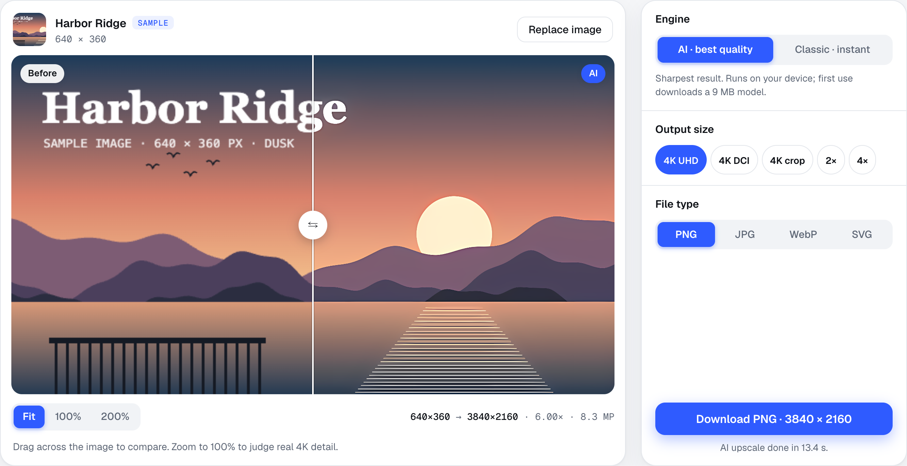
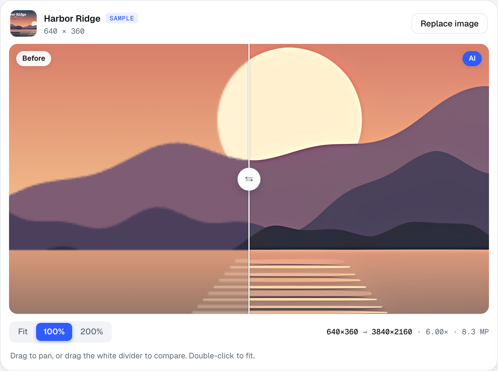
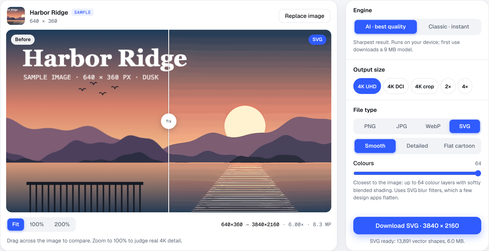
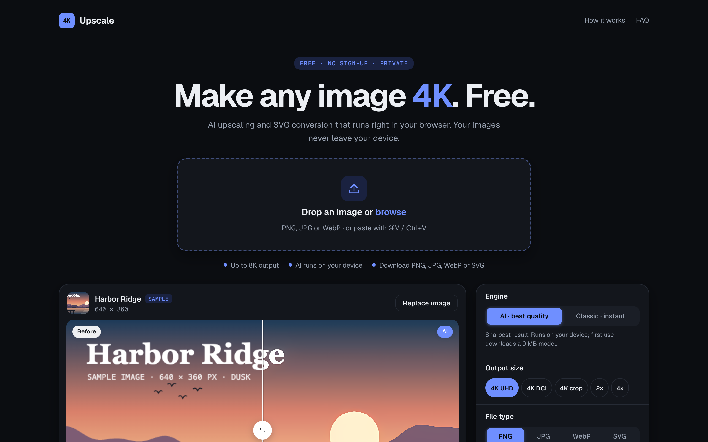
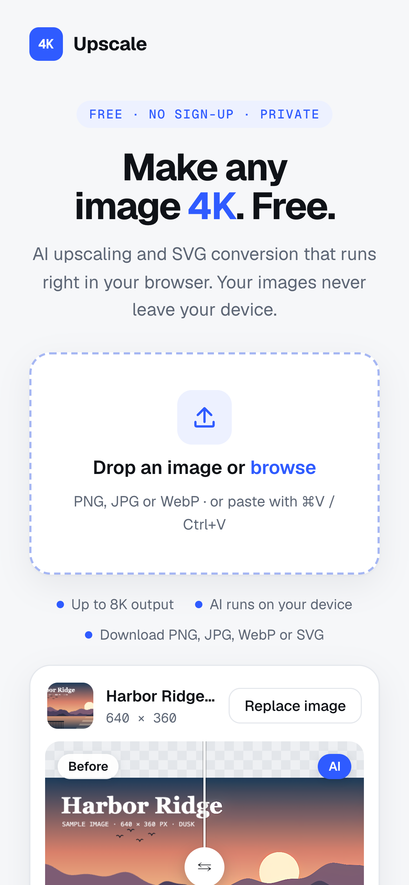
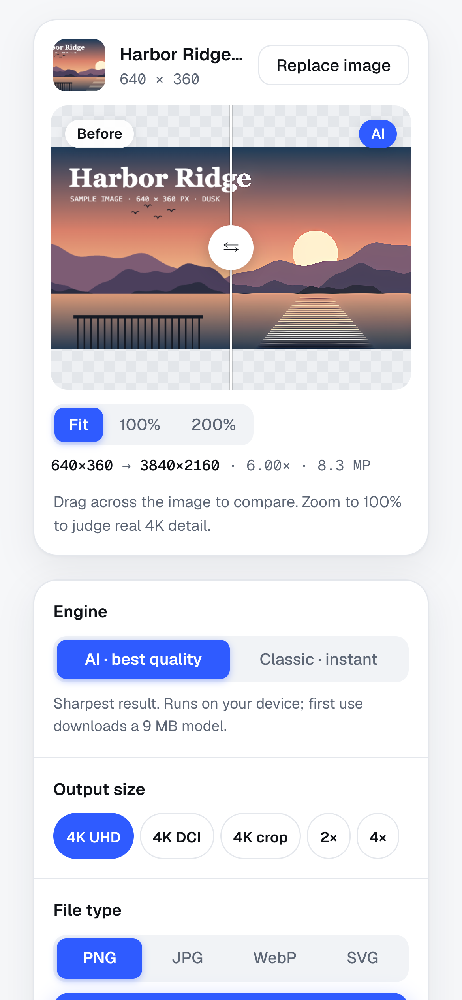

# 4K Upscaler

**Live demo:** https://upscale.185.158.132.146.sslip.io

A free web app that upscales images to 4K and converts them to SVG. All processing runs in the visitor's browser, so images are never uploaded and the site needs no server.

- **AI engine:** an RRDBNet ×4 model (Real-ESRGAN family, digital-art weights) running on the visitor's GPU with TensorFlow.js (WebGPU, falling back to WebGL).
- **Classic engine:** Lanczos-3 resampling with denoise, edge sharpening and local contrast, in a Web Worker.
- **SVG output:** colour-layer vectorizer built on VTracer (WebAssembly): Smooth, Detailed and Flat cartoon styles. Output is pure vector (paths, clip paths, blur filters), with no embedded bitmap.
- **Render memory:** every upscale and SVG is cached in the tab, so switching settings back and forth never re-renders.




## Screenshots

**Before and after.** Drag the divider to compare the original with the AI result.



**Real 4K detail.** At 100% zoom the original is blocky; the AI version has clean edges.



**SVG output.** Pure vector shapes in three styles: Smooth, Detailed and Flat cartoon.



**Dark mode** follows your system setting.



**On a phone.**

<p>
  
  &nbsp;
  
</p>

## Files

| Path | What it is |
|---|---|
| `src/app.html` | App source (UI, engines, worker code) in claude.ai artifact format |
| `index.html` | Built from `src/app.html` by `python3 tools/build.py`; this is what the site serves |
| `tools/build.py` | Wraps `src/app.html` in a full HTML document |
| `model/digital-art-4x.json` | Network graph for the AI model |
| `model/digital-art-4x.b64.txt` | Model weights, float16, base64 (8.9 MB binary) |
| `vendor/vtracer.wasm` | VTracer engine from [vtracer-wasm](https://github.com/jsscheller/vtracer-wasm) 0.1.0 |
| `.htaccess` | Compression, caching and `.wasm` type for Hostinger |
| `tools/svg-layered.js` | Standalone copy of the SVG vectorizer, for testing in Node |
| `tools/mac/` | Command-line upscaler for macOS, plus the ncnn → web model converter |

TensorFlow.js and the VTracer JS glue load from jsDelivr at runtime.

## Run locally

```bash
python3 -m http.server 8080
```

Then open http://localhost:8080. It must be served over HTTP; opening `index.html` as a file blocks the model download.

## Deploy to Hostinger

Use Git deployment in hPanel: **Websites → your site → Advanced → GIT**. Add this repository on branch `main` and leave the install path empty so the files land in `public_html`. For a private repository, add the SSH key Hostinger shows as a deploy key on GitHub (**repo → Settings → Deploy keys**). Turn on auto-deployment to redeploy on every push.

## Mac command-line tool

`tools/mac/upscale-4k.sh` upscales with [Real-ESRGAN ncnn Vulkan](https://github.com/xinntao/Real-ESRGAN/releases). Put the `realesrgan-ncnn-vulkan` binary and its `models/` folder next to the script, then run `./upscale-4k.sh photo.jpg art`.

`tools/mac/convert_ncnn.py` converts an ncnn RRDBNet model (`.param` + `.bin`) to the JSON graph and float16 weights the web app loads; `base64 -i x.bin | tr -d '\n' > x.b64.txt` makes the text file.

See `THIRD_PARTY_NOTICES.md` for licences.
